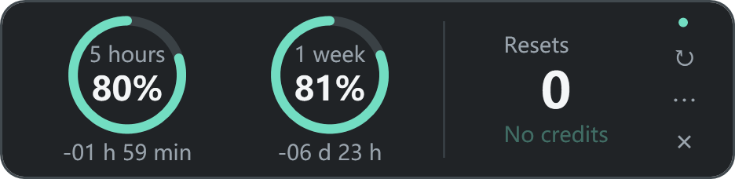

# Codex Quota Float

**A small Windows quota overlay for Codex desktop.** See your 5-hour and weekly allowance without opening the account menu.

English · [简体中文](README.zh-CN.md) · [中文简介](#中文简介)



*Demo data. The overlay shows remaining quota, not consumption.*

## Features

- Two rings show remaining **5-hour** and **weekly** quota. Labels sit above percentages inside the rings; the consumed gap advances clockwise.
- Reset countdowns: `-02 h 07 min` / `-03 d 04 h`. They update with a successful quota refresh, normally every 60 seconds, rather than ticking every second.
- Available reset credits on the right. Redemption requires explicit confirmation and server eligibility.
- **312 × 76 DIP**, docked against the screen's right edge and above the taskbar. Drag the background to move it; choose **Dock to bottom-right** to restore its position.
- Translucent when idle, opaque on hover. Choose 45%, 62%, or 80% idle opacity.
- Visible only while **Codex desktop is in the foreground and not minimized**. Its own menu and reset confirmation remain usable while the host stays visible.
- Optional sign-in watcher follows desktop launches and exits, independently of desktop process cleanup.
- **English and Simplified Chinese** via **⋯ → Language / 语言**. New installations default to English; original Chinese installations keep Chinese.

Independent and MIT licensed; not an official OpenAI product. Tracks the Codex allowance in the desktop account menu, not all ChatGPT model message caps or API billing.

## Download and run

Requires **Windows 10/11 x64**, **.NET Framework 4.8**, and Codex desktop signed in with a ChatGPT account. Its CLI must support the App Server methods below.

1. Download `CodexQuotaFloat-v0.2.0-win-x64.zip` from [Releases](https://github.com/gaoyuankarl-pixel/codex-quota-float/releases).
2. Extract the whole archive to a writable folder. Keep the EXE and `.config` together; configuration lives in `app/data/` beside the EXE.
3. Start Codex desktop, then run `app/CodexQuotaFloat.exe`. The overlay stays hidden when another application is in the foreground.
4. Run `Install.ps1` to enable the watcher at Windows sign-in, or use **⋯ → Watch Codex launches at sign-in**. No administrator rights are required.

Installation registers only **this tool's** current-user Run entry and Startup-folder shortcut. It does not change Codex desktop's own sign-in setting. With no desktop host, the watcher does not start a quota-query process.

Run `Uninstall.ps1` to remove both startup entries and stop the tool; files and pending reset records are retained. After moving the folder, run `Install.ps1` again. The EXE is currently unsigned; building from source requires no SDK or package download.

## Reset credits and data handling

Credits come from `rateLimitResetCredits.availableCount`. Unknown is not displayed as zero. Redemption requires fresh, valid data with an eligible account and available credit; the server decides which windows can be reset.

Before submission, the tool persists an idempotency key and rechecks the account and Codex data-directory context. Interrupted operations retry the same key. **Do not delete `app/data/pending-reset.json` while a reset is unconfirmed.** It contains a random operation ID and account/context hashes, not login tokens.

Queries use a local `codex app-server --listen stdio://` child process. The tool does not parse credential files, copy tokens, send model turns, or use third-party telemetry. The CLI communicates with the account service using its existing sign-in. Runtime settings and bounded diagnostics stay local and are excluded from Git and release archives.

Query failures retain old values and mark them stale. Data older than two minutes disables redemption. An elapsed countdown never invents a quota refill.

## Build and test

From the repository root, in Windows PowerShell or PowerShell:

```powershell
.\build.ps1
.\package.ps1
```

`build.ps1` uses the Windows .NET Framework C# compiler, builds the EXE, runs synthetic regression checks, and prints SHA-256. It does not install startup entries, query an account, or consume credits. `package.ps1` creates a clean ZIP and `releases/SHA256SUMS.txt`.

CI builds and packages on Windows; matching version tags publish release assets. See [CONTRIBUTING.md](CONTRIBUTING.md).

| Command | Purpose |
| --- | --- |
| `--lang=en` / `--lang=zh-CN` | Select and remember the UI language |
| `--demo` | Synthetic preview; no quota requests or resets |
| `--qa` | Show a taskbar entry for UI checks |
| `--self-test` | Offline synthetic regression tests |
| `--watch` | Background desktop-launch watcher |
| `--install` / `--uninstall` | Register/remove this tool's sign-in entries |
| `--stop` | Stop this tool and watcher; keep registration |
| `--diagnose` | Read real quota and write local diagnostics; no reset |

## Developer notes

C# 5 / WPF / .NET Framework 4.8, without NuGet dependencies. `src/L10n.cs` contains English translations; the original Chinese strings serve as stable resource keys.

| Source | Responsibility |
| --- | --- |
| `Program.cs`, `Layout.cs` | Overlay, rings, countdowns, menu, watcher loop |
| `Core.cs` | Parsing, preferences, atomic writes, reset coordination |
| `Rpc.cs` | CLI discovery and App Server JSON-RPC |
| `Native.cs` | Host validation, foreground/minimized state, window styles |
| `WatcherStartup.cs`, `StartupRegistration.cs` | Independent startup and sign-in registration |
| `Tests.cs` | Synthetic regression checks |

The protocol uses `account/rateLimits/read`, account/quota notifications, and optional `account/rateLimitResetCredit/consume`. See [OpenAI App Server documentation](https://learn.chatgpt.com/docs/app-server). Protocol and desktop install layouts can change. Host detection recognizes the Codex desktop package and excludes CLI subprocesses and unrelated applications called `ChatGPT.exe`. Mixed-DPI multi-monitor setups have not been exhaustively tested.

## 中文简介

Windows 原生 Codex 额度浮窗：用两个圆环显示 **5 小时 / 1 周剩余额度**，下方显示带负号的重置倒计时，右侧显示真实可用重置次数。仅在 Codex 桌面窗口位于前台且未最小化时显示；默认贴住屏幕右侧和任务栏上方，平时半透明、鼠标悬浮时变清晰。

新安装默认英文，可从 **⋯ → Language / 语言 → 简体中文** 切换。下载后解压运行 EXE；`Install.ps1` 开启本工具的登录监听，`Uninstall.ps1` 移除。重置需要确认，不会自动消耗次数。MIT 开源，支持自行构建与修改。完整说明见 [中文版 README](README.zh-CN.md)。

## License and acknowledgements

[MIT](LICENSE). Independently implemented, with design/protocol references from [Koodex](https://github.com/CimanesDev/Koodex), [Codex Usage Desktop](https://github.com/hanweibo4531/codex-usage-desktop), [Codex Rate Monitor](https://github.com/D1NOOO/codex-usage-monitor), and [ChatGPT Usage Overlay](https://github.com/goraeda-a11y/chatgpt-usage-overlay). No upstream binaries or artwork are bundled.
