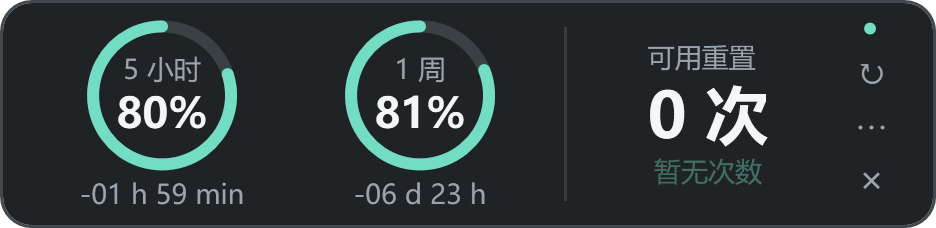

# Codex 额度浮窗

**Windows 原生 Codex 剩余额度浮窗。** 不打开账户菜单，也能查看 5 小时和 1 周的余量。

[English](README.md) · 简体中文



*图片为模拟数据；圆环显示剩余比例。*

## 功能

- 两个圆环分别显示 **5 小时 / 1 周剩余额度**。圆内上方为名称、下方为百分比；额度消耗时，缺口从顶部顺时针扩大。
- 重置倒计时格式：`-02 h 07 min` / `-03 d 04 h`。随成功的额度查询更新，正常每 60 秒同步，不额外逐秒递减。
- 右侧显示真实重置次数；符合条件且再次确认后才会消耗机会。
- **312 × 76 DIP** 横条默认贴屏幕右侧、任务栏上方；拖动空白处移动，菜单可恢复右下角停靠。
- 平时半透明、悬浮时清晰，空闲不透明度可选 45%、62%、80%。
- **仅在 Codex 桌面窗口位于前台且未最小化时显示**。切换应用后隐藏，切回后恢复。操作自己的菜单或确认框时，原桌面窗口仍可见才维持显示。
- 可选 Windows 登录监听，自动跟随桌面启动和退出，独立于桌面应用的进程清理。
- **英文 / 简体中文** 随时切换：**⋯ → Language / 语言**。新安装默认英文，原中文版本升级保留中文。

独立 MIT 开源项目，非 OpenAI 官方产品。跟踪 Codex 账户菜单中的额度，不是 ChatGPT 所有模型的消息上限或 API 账单。

## 下载与运行

需要 **Windows 10/11 x64、.NET Framework 4.8**，以及通过 ChatGPT 账户登录的 Codex 桌面。其 CLI 需支持下文的 App Server 额度接口。

1. 在 [Releases](https://github.com/gaoyuankarl-pixel/codex-quota-float/releases) 下载 `CodexQuotaFloat-v0.2.0-win-x64.zip`。
2. 完整解压到可写目录，保留 EXE 旁的 `.config`。配置位于 `app/data/`。
3. 打开 Codex 桌面，运行 `app/CodexQuotaFloat.exe`；其他应用在前台时浮窗隐藏。
4. 运行 `Install.ps1` 开启 Windows 登录监听，也可从菜单开启；不需要管理员权限。

仅注册**本工具**的当前用户 Run 项与 Startup 快捷方式，不更改 Codex 桌面本身的自启动设置。无宿主时，不创建额度查询进程。

`Uninstall.ps1` 移除两个启动入口并停止工具，保留文件和待确认重置记录。移动目录后重新运行 `Install.ps1`。当前 EXE 未签名，也可以自行编译。

## 重置次数与数据

次数来自服务端 `rateLimitResetCredits.availableCount`，未知不会伪装成 0。只有数据有效、新鲜且账户与次数符合条件，才能点击重置；恢复哪些窗口由服务端决定。

提交前持久化幂等键，并核对账户及 Codex 数据目录。网络中断或结果未确认时，重试沿用原请求以避免重复消耗。**未确认重置期间，不要删除 `app/data/pending-reset.json`。** 它只包含随机操作标识、账户与目录哈希，不保存令牌。

通过本地 `codex app-server --listen stdio://` 子进程读取额度，不解析认证文件、不复制令牌、不发送模型请求，无第三方遥测。CLI 用现有登录与账户服务通信。配置与有大小上限的诊断留在本机，不进入 Git 或发布包。

查询失败时保留旧值并标记状态；超过两分钟的数据禁止重置。倒计时结束不自行把额度改成 100%。

## 构建与测试

仓库根目录运行：

```powershell
.\build.ps1
.\package.ps1
```

使用 Windows 自带的 .NET Framework C# 编译器，不需 SDK 或 NuGet。构建生成 EXE、运行模拟回归并打印 SHA-256，不注册启动项、不查询真实账户、不消耗重置。打包生成干净 ZIP 与 `releases/SHA256SUMS.txt`。

GitHub Actions 在 Windows 执行相同构建，匹配的版本标签触发发布。开发指导见 [CONTRIBUTING.md](CONTRIBUTING.md)。

| 参数 | 用途 |
| --- | --- |
| `--lang=en` / `--lang=zh-CN` | 选择并记住语言 |
| `--demo` | 模拟预览，不查询账户或重置 |
| `--qa` | 在任务栏显示窗口，便于检查 |
| `--self-test` | 离线模拟回归检查 |
| `--watch` | 后台监听桌面启动 |
| `--install` / `--uninstall` | 注册 / 移除本工具启动入口 |
| `--stop` | 停止浮窗与监听，保留启动设置 |
| `--diagnose` | 读取真实额度并写本地诊断，不重置 |

## 开发者说明

C# 5 / WPF / .NET Framework 4.8。`src/L10n.cs` 集中管理英文翻译，原中文作为资源键。模块分工见 [英文 README](README.md#developer-notes)。

协议包括 `account/rateLimits/read`、账户与额度更新通知，以及可选的 `account/rateLimitResetCredit/consume`。参考 [OpenAI App Server 文档](https://learn.chatgpt.com/docs/app-server)。协议和桌面安装布局可能变化；宿主识别针对 Codex 桌面包，排除 CLI 和无关同名应用。不同缩放比例的多显示器尚未穷尽测试。

## 许可证与参考

[MIT](LICENSE)。独立实现，参考 [Koodex](https://github.com/CimanesDev/Koodex)、[Codex Usage Desktop](https://github.com/hanweibo4531/codex-usage-desktop)、[Codex Rate Monitor](https://github.com/D1NOOO/codex-usage-monitor)、[ChatGPT Usage Overlay](https://github.com/goraeda-a11y/chatgpt-usage-overlay) 的交互和协议设计，未包含上游二进制或美术资源。
